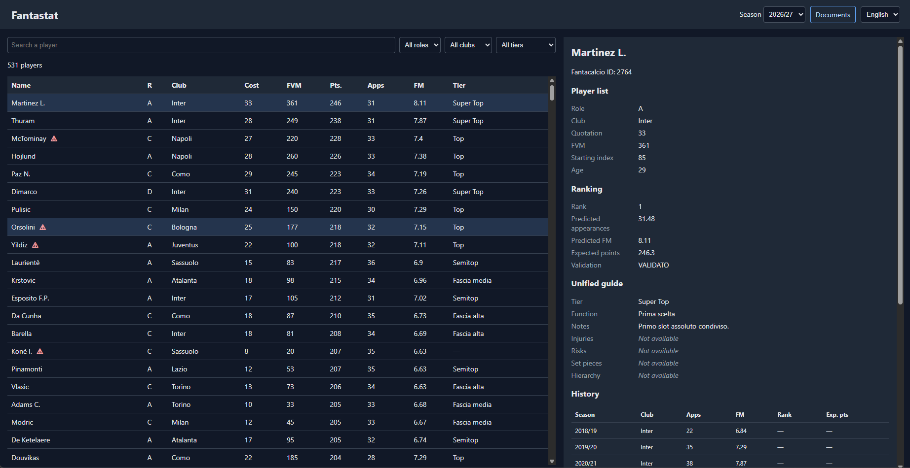

# Fantastat

Preparation and analysis tool for the yearly **Serie A Fantacalcio
Classic** league auction. It organizes the player list, studies historical
performance and auction prices, and produces a **transparent statistical
ranking** of players, to be combined with current football knowledge and
auction strategy.

> The ranking is a quantitative signal, not a complete auction recommendation:
> current prices, injuries, likely lineups and transfers are still up to the
> manager.



## What it does

- **Per-role ranking** (P, D, C, A): estimates expected appearances and fantasy
  average from a window of recent seasons, weighting newer seasons more
  heavily (simple weighted averages, no machine learning).
- **Validation** of the model through temporal-fold backtesting.
- **Season research** (lineups, injuries, set-piece takers, goalkeeper
  hierarchies, transfers) as human decision support.
- **Auction advisor skill** (`.agents/skills/fantastat-auction-advisor`): lets
  you ask the LLM questions during the auction, answered from the repository's
  docs, the unified auction guide and the player-level data.
- **Offline auction UI**: read-only local server over a SQLite snapshot, no
  Internet services, available in English and Italian.

## 2026/27 league

10 teams, 3 GK + 8 DEF + 8 MID + 6 FWD per roster, calling-order auction, a
budget of 500 credits usable across all roles plus 50 reserved for forwards,
and a defense modifier when at least 4 defenders are fielded. Details in
[`docs/RULES.md`](docs/RULES.md) (Italian).

## Requirements

- Python 3 with `pandas` and `openpyxl` (everything else is standard library).
  No build step.
- An **LLM** (ideally a frontier model with an agentic coding tool, such as
  Claude Code). Several workflow steps are not automated by scripts: they
  rely on an LLM to read the source material and to produce or update the
  research notes, the auction guide and the unified player guide.

## Quick start

Preparing a season is a guided process: follow
[`docs/WORKFLOW.md`](docs/WORKFLOW.md) step by step, using an LLM for the
steps that call for one. The workflow covers downloading the player lists,
converting the workbooks, collecting the season research, generating the
ranking and building the snapshot.

Once the season artifacts exist, start the offline auction UI from the
repository root:

```powershell
python src/auction_ui.py    # http://127.0.0.1:8765
```

Use `--port` and `--database` to change port or snapshot. If the snapshot is
missing, the workflow builds it (`python src/build_snapshot.py`).

Tests:

```powershell
python -m unittest discover -s src/tests -v
```

## Layout

| Path | Contents |
| --- | --- |
| `src/` | Code: `ranking.py`, `run_ranking.py`, `convert_workbooks.py`, `build_snapshot.py`, `auction_ui.py`, `config.yaml`, tests |
| `specs/` | Source of truth for behavior: formulas, validation, output schemas |
| `data/player_lists/` | Official Fantacalcio.it and Fantacalcio Online player lists (xlsx + CSV) |
| `data/stats/` | Historical statistics per season (xlsx + CSV, see `LEGEND.md`) |
| `data/seasons/` | Season research from press sources |
| `data/auction_guide/` | Source material for the auction guide |
| `docs/` | League rules, auction guide, workflow, UI documentation |
| `output/` | Reproducible artifacts (ranking, validation, snapshot) |

## Configuration

`src/config.yaml`: 5-season history window, recency weights `[10, 5, 3, 2, 1]`
(newest first), validation parameters.

## Documentation

Most documents are written in Italian.

- [`specs/player_ranking.md`](specs/player_ranking.md): ranking specification
- [`docs/WORKFLOW.md`](docs/WORKFLOW.md): how to prepare a new season
- [`docs/OFFLINE_AUCTION_UI.md`](docs/OFFLINE_AUCTION_UI.md): offline auction UI
- [`docs/GUIDA_ASTA.md`](docs/GUIDA_ASTA.md): auction strategy
- [`docs/RULES.md`](docs/RULES.md): league rules
- [`AGENTS.md`](AGENTS.md): contribution guidelines

## Privacy

`docs/private/` and `data/chats/` hold personal data about league members and
are **not tracked in git**. Historical auction records are partly reconstructed
from photos and chat messages: uncertain names and prices must not be treated
as verified.